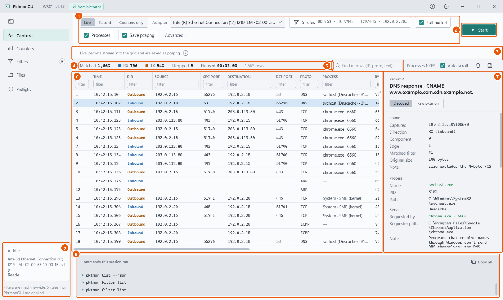

# PktmonGUI

A portable, no-install GUI for `pktmon`, the packet monitor built into Windows 10 2004+ and Server 2022+.
It's one `PktmonGUI.exe` (.NET Framework 4.7.2, which is in-box on those systems) and it runs elevated.
The same exe also records captures without a window, on one host or many.



## Documentation

- **[User Guide](docs/user-guide.md)**: what pktmon is and what PktmonGUI adds, then each screen step by step: Preflight, capturing, reading and filtering packets, filter rules, counters, converting files and analysing them in Wireshark.
- **[Admin Guide](docs/admin-guide.md)**: deploying the exe, shipping it with a `settings.json`, headless captures and their options, remote capture over WinRM, Group Policy, Configuration Manager and PsExec, and security notes.

Both guides are also attached to each release as one PDF.

## What it does

- **Preflight** checks the machine before anything changes: elevation, pktmon, the working folder, settings, and filters already on the machine. It picks adapters by MAC, because pktmon component IDs change at reboot.
- **Capture** in *Live* (packets stream into a sortable, filterable grid, with a decoder that explains every symbol pktmon prints), *Record* (an `.etl`) or *Counters only* mode.
- **Filters** is a rule builder that shows pktmon's own logic, with presets and JSON import/export. Filters PktmonGUI didn't create, such as Defender for Endpoint's, are saved before they're cleared and put back on exit.
- **Processes.** pktmon doesn't record which process a packet belongs to; PktmonGUI works it out from ETW beside the capture, including the program a DNS lookup was made for, and writes it into the pcapng as a comment on every packet.
- **Counters** shows per-component counts, drops and drop reasons, and per-rule tallies in Live mode.
- **Files** converts captures to pcapng (joining multi-file recordings) or text, and opens them in Wireshark without administrator rights.
- **Headless mode**: `PktmonGUI.exe --capture --duration 10m --preset dns` records, restores the machine and hands back one zip.

On exit PktmonGUI always stops its capture and leaves the machine's filters as it found them.

## Quick start

1. Download `PktmonGUI.exe` from the releases page, or build it (below).
2. Run it and approve the administrator prompt.
3. On **Preflight**, tick an adapter and click **Continue to capture**.
4. Click **Start**, then **Stop**, then **Open in Wireshark**.

The [User Guide](docs/user-guide.md#quick-start-your-first-capture) walks through it with screenshots.

## Build

```
dotnet build src/PktmonGUI -c Release    # → src/PktmonGUI/bin/Release/net472/PktmonGUI.exe (all DLLs embedded via Costura)
```

The `.exe.config` next to the build output is optional; the exe runs on its own.
