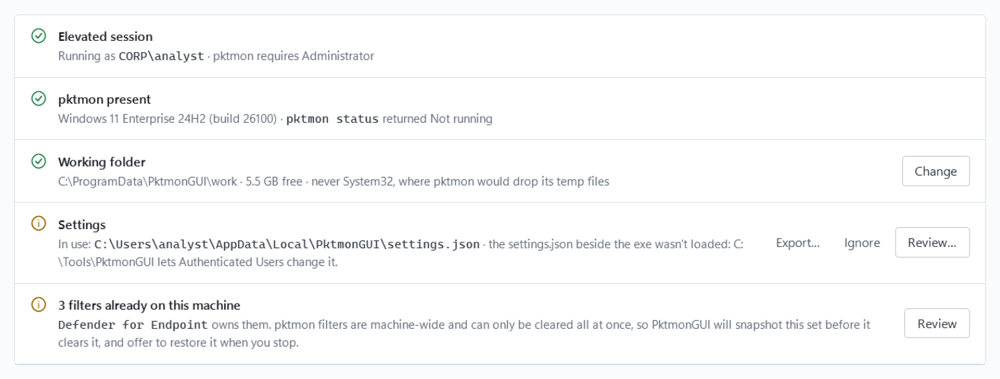

# PktmonGUI Admin Guide

This guide is for administrators who deploy PktmonGUI, ship it with preset settings, or run captures without its window: on servers, on many hosts at once, or from Group Policy, Configuration Manager, WinRM or PsExec.

Using the window itself is covered in the [User Guide](user-guide.md).

## Contents

- [Two ways to run it](#two-ways-to-run-it)
- [Deploying PktmonGUI](#deploying-pktmongui)
- [Shipping settings with the exe](#shipping-settings-with-the-exe)
- [Headless captures](#headless-captures)
- [Capturing on remote hosts](#capturing-on-remote-hosts)
- [Security considerations](#security-considerations)
- [Logs and recovery](#logs-and-recovery)
- [Known limits](#known-limits)

## Two ways to run it

`PktmonGUI.exe` is one file with two modes:

- **With no arguments** it opens the window, in an interactive session only. That's the [User Guide](user-guide.md).
- **With any argument** it runs *headless*: no window. It records a capture, puts the machine back as it found it, and hands back one zip with the capture (as `.etl` and as pcapng with a process comment on every packet), counters, a log and a result file. The same exe, copied to a host by any means, does the whole job on its own.

Both modes need administrator rights, or SYSTEM.

## Deploying PktmonGUI

### Where to put the exe

Put it in `%ProgramFiles%\PktmonGUI`. SYSTEM and administrators run it from there, and only administrators can create or change anything under Program Files, so nobody else can replace it.

Don't use `%ProgramData%` or a folder at the root of a drive: any signed-in user can create folders there, and a user who creates the folder before you do can replace what you put in it. A copy on a file share is fine for running once (headless `--detach` copies itself locally first), but don't make a share the permanent home of an exe that runs as SYSTEM.

### Signing and allowlisting

Endpoint protection may flag what a capture does: an ETW session, a process started through WMI (`--detach`), and zipping and copying files to a share. Allowlist the exe before you deploy it, or the capture may be blocked partway.

The released exe isn't signed. Allowlist it one of two ways:

- **By hash.** Works with the exe as downloaded, but each new version needs a new rule.
- **By your certificate.** Sign the exe with your organization's code-signing certificate, then allowlist the certificate. One rule then covers every later version you sign. Signing changes the file's hash, and it means you vouch for the file, so you may prefer to build it from source (see the README) and sign your own build.

The Microsoft Defender attack surface reduction rule *Block process creations originating from PSExec and WMI commands* blocks `--detach`'s WMI launch. `--detach` then falls back to breaking away from the calling job, if the job allows it.

### What it writes, and where

| What | Where | Who can change it |
|---|---|---|
| The window's settings, presets and filter snapshots | `%LOCALAPPDATA%\PktmonGUI` | The user |
| Captures made in the window (the working folder) | `%ProgramData%\PktmonGUI\work` by default | Administrators and SYSTEM |
| Headless state, runs, logs and snapshots | `%ProgramData%\PktmonGUI` | Administrators and SYSTEM |
| A settings template | `settings.json` beside the exe, if you put one there | Whoever can change that folder |

PktmonGUI never writes beside the exe. Headless runs never touch the window's settings.

## Shipping settings with the exe

A `settings.json` beside `PktmonGUI.exe` is a *template*: preferences to ship with the tool. PktmonGUI reads it, and only writes one when you export to it.

- **The window** imports its preferences each time the file changes, and keeps the user's own changes in between. Preflight's **Settings** row shows which file is in use and where it was imported from; so does hovering over the version number in the title bar.
- **Headless captures** take their defaults from it (see [Defaults from settings.json](#defaults-from-settingsjson)).

The easiest way to make one is to set up PktmonGUI's window the way you want it, then click **Export…** on Preflight's **Settings** row. The export holds every preference a template can set, and none of the machine's state: not its adapters' MAC addresses, nor the filters PktmonGUI applied, nor its import history. The working folder is left out while it's the default, so each machine keeps its own. Don't copy the live `settings.json` from `%LOCALAPPDATA%\PktmonGUI` instead: it carries that state with it, and it's only brought up to date when the window closes.

A template can also hold just the fields you want to set, for example:

```json
{ "recordFileSizeMb": 64, "recordLogMode": "MultiFile" }
```

or `{ "showTourAtStartup": false }` to stop offering the guided tour.

### What a template can set

| Field | Sets |
|---|---|
| `workingFolder` | The working folder: a full local path outside the Windows folder, e.g. `D:\Captures` |
| `fullPacket`, `snapLength` | Full packets, or the bytes logged per packet |
| `attributeProcesses` | Process attribution on or off |
| `saveLivePcap`, `livePcapMaxMb` | Saving Live captures as pcapng, and its size limit (2048 MB by default) |
| `lastMode` | The capture mode the window opens in: `Live`, `Record` or `CountersOnly` |
| `recordFileSizeMb`, `recordLogMode` | Record mode's file size and log mode (`Circular`, `MultiFile` or `Memory`) |
| `draftRules` | The Filters page's rules |
| `liveRowCap` | How many rows the packet grid keeps (at least 1,000) |
| `countersRefreshSeconds` | How often the Counters page updates (1 to 3,600 seconds) |
| `autoScroll` | The grid's Auto-scroll |
| `theme` | `Dark`, `Light` or `System` |
| `sidebarCollapsed`, `showTourAtStartup` | The sidebar, and whether the tour is offered |
| `windowWidth`, `windowHeight`, `windowMaximized` | The window's size |

Every value is checked as if it had been typed in. A template never carries the machine's own state: which filters are PktmonGUI's, the chosen adapters, or snapshots.

### When a template is trusted

The window runs elevated and headless captures run as SYSTEM, both using these values. So the template is used only when nobody but an administrator could have written it, which means all of these:

- it's in a local folder owned by Administrators that no other account can change, such as `%ProgramFiles%\PktmonGUI` (never on a share, where "Administrators" means the file server's);
- it isn't a link;
- no other account can change the file. A file owned by an administrator's own account is given to Administrators.

The file is checked and read through one handle, so it can't be swapped in between.

### When it isn't

**In the window**, Preflight's **Settings** row turns yellow and says why. **Review…** lists every change the template would make before importing it; **Ignore** keeps the current settings and stops offering this version of the file.



**A headless capture** stops with exit code 2 and the reason. `--no-settings` captures without the template.

### Defaults from settings.json

Headless captures take these defaults from a trusted template. Flags on the command line always win, and `result.json` and `run.log` record which defaults came from the file.

| Field | Gives |
|---|---|
| `workingFolder` | `--out` |
| `recordFileSizeMb` | `--file-size` |
| `recordLogMode` | `--log-mode` |
| `fullPacket`, `snapLength` | `--pkt-size` |
| `attributeProcesses` | `--no-attribution` |
| `draftRules` | `--filter`, unless `--filter`, `--preset`, `--filters-file` or `--keep-filters` is given |

## Headless captures

### Commands

```
PktmonGUI.exe --capture --duration 10m --preset dns          # 10 minutes of DNS, on every adapter
PktmonGUI.exe --capture --filter "-t TCP -p 443" --detach    # in the background until --stop (24 h at most)
PktmonGUI.exe --stop                                          # stop it and wait for the zip
PktmonGUI.exe --status                                        # what's running, the last result, leftovers
PktmonGUI.exe --cleanup                                       # put the machine back after a capture was killed
PktmonGUI.exe --list-adapters                                 # the names, MACs and IDs --comp accepts
PktmonGUI.exe --help                                          # every option
PktmonGUI.exe --version
```

`--capture` is implied by any capture option.

### Options

**What to capture**

| Option | Does |
|---|---|
| `--duration <time>` | Stop after `90s`, `10m`, `2h`, `1h30m` or `hh:mm:ss`; `0` means no limit. Default: until `--stop` or Ctrl+C (24 hours with `--detach`) |
| `--comp <list>` | Where to capture, comma-separated. `nics` (the default) is every network adapter; `default` is the adapter with the default gateway; or a component ID, a MAC (every adapter with it), or a connection name, adapter name or description (a unique part is enough; `*` and `?` select several) |
| `--filter "<args>"` | One pktmon filter, written as for `pktmon filter add` (short or long options), e.g. `--filter "-t TCP -p 443"` or `--filter "DC -i 10.0.0.10 -t UDP -p 53"`. Repeatable; rules are ORed; at most 32 |
| `--preset <name>` | Built-in rules: `dns`, `rdp`, `smb`, `ldap-kerberos`, `tcp-syn`, `tcp-rst`, `icmp`, `cdp-lldp`, `arp`, `dhcp`, `https`. Repeatable, or comma-separated |
| `--filters-file <file>` | Rules exported from the window's Filters page |
| `--keep-filters` | Capture through the machine's current filters, unchanged |
| `--pkt-size <bytes>` | Bytes logged per packet; `0` is the whole packet (the default) |
| `--type <type>` | `all` (the default), `flow` for normal traffic only, or `drop` for drops only |
| `--file-size <MB>` | The `.etl` size limit, e.g. `512` (the default) or `2GB` |
| `--log-mode <mode>` | `circular` (the default) keeps the newest packets once the file is full; `multi-file` starts another file, and the capture stops if free space runs low |
| `--no-attribution` | Don't record which process owns each packet |
| `--no-pcap` | Keep the `.etl` only; skip the conversion to pcapng |
| `--no-settings` | Ignore the `settings.json` beside the exe |

**Where results go**

| Option | Does |
|---|---|
| `--out <folder>` | Local folder for runs (not UNC). Default: `%ProgramData%\PktmonGUI\runs` |
| `--collect <folder>` | Copy the finished zip here, e.g. `\\fs01\pktmon$` |
| `--keep-local` | Keep the unzipped run folder, and the local zip after `--collect` |
| `--log <file>` | Also append the run log to this file |

A local `--out`, `--collect` or `--log` folder must be one only administrators can change; a missing one is created that way. One that other accounts can change, or a link, is refused (exit 2) unless you add `--force`. Note that a new folder at the root of a drive, such as `D:\captures`, lets every signed-in user change it by default.

**How it runs**

| Option | Does |
|---|---|
| `--detach` | Record in a background process that outlives this one; return once the capture is running |
| `--force` | With `--capture`: stop a pktmon session someone else left running, and accept output folders other accounts can change. With `--cleanup`: also stop sessions and restore filters that aren't clearly a headless capture's |
| `--purge` | With `--cleanup`: also delete old runs and copies of the exe under `%ProgramData%\PktmonGUI` |
| `--timeout <time>` | How long `--stop` and `--detach` wait. Default: 15 minutes for `--stop`, 60 seconds for `--detach` |
| `--json` | Print one JSON document, in plain ASCII, instead of text |
| `--quiet` | Print only warnings, errors and the final line |

### What a capture does

1. **Checks** that it's elevated, Windows is build 19041 or later, pktmon is idle and there's disk space. `--force` stops a pktmon session someone else left running.
2. **Filters.** It saves the machine's filters, then replaces them with yours, or clears them if you gave none. Rules are named `PktmonGUI <name>`, so leftovers are easy to recognize. `--keep-filters` captures through the machine's filters instead.
3. **Records** in Record mode with process attribution, on every adapter unless `--comp` says otherwise. Until the zip is done, it keeps Windows from sleeping when idle (`powercfg /requests` lists it); a sleep someone asks for still happens.
4. **Stops** on `--duration`, `--stop`, Ctrl+C, free space under 1 GB, or when pktmon ends on its own.
5. **Restores first.** It stops pktmon and puts the machine's filters back before anything slow.
6. **Converts and zips.** Each `.etl` is converted to pcapng with a `Process:` comment on every packet, and the run folder is zipped as `<HOST>-<yyyyMMdd-HHmmss>.zip`. With `--collect`, the zip is copied there. The local copies are deleted only once the zip, or its copy on the share, checks out; `--keep-local` keeps them. `result.json`'s `zip` always says where the zip is.

Run folders and zips are made for SYSTEM and Administrators only, wherever they go.

### What's in the zip

| File | What it is |
|---|---|
| `<run>.etl`, `<run>.pcapng` | The capture, and its conversion with process comments |
| `<run>.meta.json`, `<run>.attribution.json` | The capture's details and process data, the same files the window's Files page reads |
| `counters.txt`, `counters.json` | pktmon's counters at stop, with drop reasons |
| `components.txt`, `filters-before.txt` | The adapters, and the filters found on the machine |
| `run.log` | Every command run, with its output |
| `result.json` | Status, exit code, packet counts, warnings and errors |

Unzip it on your workstation and open the `.pcapng` in Wireshark, or copy the `.etl` and its sidecars into a working folder to browse them on the window's Files page. The [User Guide](user-guide.md#analysing-a-capture-in-wireshark) shows how to use the process comments in Wireshark.

### State on the host

`%ProgramData%\PktmonGUI` is owned by Administrators and open to SYSTEM and Administrators only. It holds:

| Path | What |
|---|---|
| `headless.json` | The running or last capture. It's how `--stop` finds a capture that a SYSTEM task started |
| `cli-settings.json` | Headless mode's own settings |
| `snapshots\` | The machine's filters, saved before a capture replaced them |
| `runs\` | The default `--out` |
| `bin\` | Where `--detach` copies an exe that runs from a share |
| `cli.log` | What happened outside a run folder (see [Logs and recovery](#logs-and-recovery)) |
| `work\` | The window's captures |

Every command checks this folder before writing to it. If the folder, or anything in it, is owned by an account other than Administrators, SYSTEM or TrustedInstaller, can be changed by another account, or is a link, it's renamed `PktmonGUI.untrusted-<date>` and made again; the reason is in `cli.log` and the command's warnings. A file owned only by another account (for example, one an administrator created on Windows 10 or 11) gets Administrators as its owner instead.

### Output, waiting and exit codes

`PktmonGUI.exe` is a Windows (GUI-subsystem) program, so shells neither wait for it nor show its output unless asked:

- **PowerShell:** `& .\PktmonGUI.exe --status | Out-Host; $LASTEXITCODE`, or `(Start-Process .\PktmonGUI.exe '--status' -Wait -PassThru -NoNewWindow).ExitCode`. Remotely, `& PktmonGUI.exe … | Out-String` waits and sets `$LASTEXITCODE`.
- **cmd:** `start "" /wait PktmonGUI.exe --status`, then `%errorlevel%`. A `.cmd` script waits on its own; typed at the prompt, it returns at once and the output lands under the next prompt.
- A caller that isn't elevated can't start it at all (Windows error 740, *The requested operation requires elevation*).

| Exit code | Meaning |
|---|---|
| 0 | OK |
| 1 | Failed |
| 2 | Usage error; nothing was changed |
| 3 | Not elevated, Windows too old, pktmon missing or denied, not enough disk, or another account created PktmonGUI's lock or stop signal |
| 4 | Busy: another headless capture or pktmon session is running (`--status` shows which) |
| 5 | `--collect` failed; the zip is kept locally |
| 6 | Done with warnings (see `result.json`), e.g. conversion failed and the `.etl` was kept |
| 7 | Nothing to stop; for `--status`, leftovers found |
| 8 | The machine's filters or session couldn't be put back: run `--cleanup` |
| 9 | `--stop` or `--detach` timed out waiting |

## Capturing on remote hosts

### WinRM

```powershell
$s = New-PSSession SRV01
Invoke-Command -Session $s { New-Item -ItemType Directory -Force "$env:ProgramFiles\PktmonGUI" | Out-Null }
Copy-Item .\PktmonGUI.exe -Destination 'C:\Program Files\PktmonGUI' -ToSession $s
Invoke-Command -Session $s { & "$env:ProgramFiles\PktmonGUI\PktmonGUI.exe" --capture --detach --duration 30m --preset smb | Out-String }
```

- **Use `--detach`.** WinRM ends a shell's processes when the session closes, and the capture with them. `--detach` starts the capture through WMI (`Win32_Process.Create`), outside the session.
- **Get the zip back with `Copy-Item -FromSession`.** `--collect` to a share fails from WinRM, because the session has no credentials to pass on to a third server (the "double hop").
- For local (non-domain) administrator accounts, UAC filters remote tokens unless `LocalAccountTokenFilterPolicy` is 1 on the target.

### Invoke-RemotePktmon.ps1

`tools\Invoke-RemotePktmon.ps1` does all of that for many hosts at once, in parallel, and returns one result per host. `Get-Help .\tools\Invoke-RemotePktmon.ps1 -Full` lists every parameter.

```powershell
.\tools\Invoke-RemotePktmon.ps1 -ComputerName SRV01,SRV02 -Action Start -Duration 30m -Preset dns
.\tools\Invoke-RemotePktmon.ps1 -ComputerName SRV01,SRV02 -Action Status
.\tools\Invoke-RemotePktmon.ps1 -ComputerName SRV01,SRV02 -Action Stop
.\tools\Invoke-RemotePktmon.ps1 -ComputerName SRV01,SRV02 -Action Collect -Destination D:\captures
.\tools\Invoke-RemotePktmon.ps1 -ComputerName (Get-Content hosts.txt) -Action Run -Duration 5m -Filter '-t TCP -p 443'
```

| Action | Does |
|---|---|
| `Start` | Copies `PktmonGUI.exe` (and `settings.json`) to the host if they changed, and starts a detached capture |
| `Stop` | Stops it, restores the host's filters, converts and zips |
| `Status` | `--status` on each host |
| `Collect` | Copies each host's last zip to `-Destination\<host>\` and checks its SHA-256 |
| `Cleanup` | `--cleanup`, after a capture was killed (`-Purge` also deletes old runs) |
| `Run` | Start, wait for `-Duration`, stop any host still recording, then collect. Sessions that break meanwhile (the host slept, rebooted or dropped off the network) are reopened |

It deploys to `%ProgramFiles%\PktmonGUI`, and refuses a `-RemoteFolder` that accounts other than administrators can change. A `settings.json` beside `-ExePath` (or given with `-SettingsPath`) is deployed with the exe; when there's none, one left on the host earlier is removed, so hosts never use stale defaults. `-UseAdminShare` collects through `\\host\C$` instead of the session, which is faster for large zips.

Windows PowerShell 5.1 quotes arguments to native programs itself: keep filter text free of double quotes, and don't end a path argument with a backslash.

### Group Policy

1. **Preferences ▸ Windows Settings ▸ Files** copies `PktmonGUI.exe` from SYSVOL to `%ProgramFilesDir%\PktmonGUI\PktmonGUI.exe`.
2. **Preferences ▸ Control Panel Settings ▸ Scheduled Tasks** adds an *Immediate Task*:
   - program `%ProgramFilesDir%\PktmonGUI\PktmonGUI.exe`, user `NT AUTHORITY\SYSTEM`, *Run with highest privileges*;
   - arguments, e.g. `--capture --duration 30m --preset dns --collect \\fs01\pktmon$`;
   - *Stop the task if it runs longer than* the duration plus time to convert;
   - on the **Common** tab, *Apply once and do not reapply*. Without it, the task runs again at every policy refresh.

A startup script works too, with `--detach`: Windows waits only 10 minutes for startup scripts.

### Configuration Manager (SCCM / MECM)

Use a package program that runs, e.g., `PktmonGUI.exe --capture --duration 30m --collect \\fs01\pktmon$`:

- *Hidden*, and *Whether or not a user is logged on* (so it runs as SYSTEM);
- *Maximum allowed run time* of the duration plus 15 minutes.

Any exit code other than 0 reports as a failure. 6 means the capture finished, but `result.json` has warnings.

### PsExec

```
psexec \\SRV01 -s -c -f PktmonGUI.exe --capture --duration 5m --collect \\fs01\pktmon$
```

- `-s` runs it as SYSTEM, so `--collect` uses the computer account.
- `-c -f` copies the exe over.
- PsExec passes the exit code back.

### Collecting to a share as SYSTEM

A capture running as SYSTEM reaches a share as the computer account (`DOMAIN\HOST$`). For a drop box that computers can write to but can't read each other's captures from:

- share permission: *Domain Computers: Change*;
- NTFS on the folder: *Domain Computers*, this folder only: Create files, Create folders, Write attributes, Write extended attributes;
- NTFS: *CREATOR OWNER*, subfolders and files only: Modify;
- test it with `psexec -s cmd /c "echo x > \\fs01\pktmon$\test.txt"`.

## Security considerations

- **Captures hold secrets.** Full packets contain whatever crosses the wire unencrypted, and even encrypted traffic shows who talks to whom. Run folders, local zips and the window's working folder are already for SYSTEM and Administrators only; restrict access to the `--collect` share as above, and treat collected zips as sensitive data.
- **Filters are machine-wide.** A capture replaces the machine's filters, including those of Microsoft Defender for Endpoint (`SenseNdr…`). Both modes save them first and put them back when the capture ends. If MDE re-adds its filters mid-capture, pktmon applies them from then on, and `result.json` warns about it.
- **Viewers run without administrator rights.** The window opens Wireshark and the text viewer through Explorer, as the signed-in user at medium integrity, so a parser bug in them can't run as administrator.
- **Settings are trusted only from administrator-only folders** (see [When a template is trusted](#when-a-template-is-trusted)), and every folder PktmonGUI writes to as SYSTEM is checked first.
- **Allowlist it.** See [Signing and allowlisting](#signing-and-allowlisting).

## Logs and recovery

- **`run.log`**, in each zip, has every command a capture ran and its output.
- **`%ProgramData%\PktmonGUI\cli.log`** covers what happened outside a run folder: after zipping, runs that failed early, `--cleanup`, and usage errors.
- **The window** lists every command it ran on each page, and writes `crash.log` in its settings folder if something goes wrong.

If a capture is killed outright, pktmon keeps recording and the machine's filters stay replaced:

- `--status` reports the leftovers (exit code 7), and `--cleanup` puts things back. `--cleanup` only touches what is clearly a headless capture's; add `--force` for the rest.
- The next headless capture recovers on its own before starting.
- The window's Preflight offers to stop a leftover session and to restore saved filters.

## Known limits

- **Hyper-V hosts:** with the default `--comp nics`, a packet can appear twice, on the vNIC and on the physical NIC.
- **Long captures:** circular logging keeps only the newest `--file-size` (512 MB by default). At 100 Mbit/s of full packets that's under a minute. Narrow the capture with filters, log headers only (`--pkt-size 128`), or raise `--file-size`. `--log-mode multi-file` keeps everything, and stops when free space drops under 1 GB.
- **Real-time output is text.** pktmon's real-time mode prints a summary of each packet, not its bytes, so the window's decoder only explains what pktmon printed. Live captures saved as pcapng, and Record captures, have the real bytes.
- **Wi-Fi:** `etl2pcap` is documented for wired Ethernet. The Wi-Fi relabelling offered on the Files page is experimental.
- **Restored filters** come back owned by PktmonGUI rather than their original owner. A reboot clears every pktmon filter anyway.
