# PktmonGUI User Guide

This guide shows how to capture and read network traffic with **PktmonGUI**'s window: what each screen does, step by step, and how to get from a capture to an answer. It's written for Windows administrators, as well as network and security engineers who know Windows well, but may not be familiar with PktMon.

Running captures without the window, deploying **PktmonGUI** to many machines, and shipping it with settings are covered in the [Admin Guide](admin-guide.md).

## Contents

- [Introduction](#introduction)
- [Before you start](#before-you-start)
- [Key concepts](#key-concepts)
- [Quick start: your first capture](#quick-start-your-first-capture)
- [Preflight](#preflight)
- [Capture](#capture)
- [Reading packets](#reading-packets)
- [Filters](#filters)
- [Counters](#counters)
- [Files](#files)
- [Analysing a capture in Wireshark](#analysing-a-capture-in-wireshark)
- [Common tasks](#common-tasks)
- [Closing PktmonGUI](#closing-pktmongui)
- [The tour, themes and shortcuts](#the-tour-themes-and-shortcuts)
- [Troubleshooting](#troubleshooting)
- [Glossary](#glossary)

## Introduction

### What PktmonGUI is

PktmonGUI is a graphical front end for **pktmon**, the packet monitor built into Windows. It's a single portable file, `PktmonGUI.exe`: nothing to install, no drivers to add. It runs on the .NET Framework 4.7.2, which every supported version of Windows already has.

Because pktmon needs administrator rights, so does PktmonGUI. It never changes anything on the machine until you ask it to, and when it closes - it leaves the machine's packet filters as it found them.

### What pktmon is

pktmon (`pktmon.exe`, in `C:\Windows\System32`) is Microsoft's packet capture tool. It ships with Windows 10 (OS Build 1809) and Windows Server 2019 onwards; let us note that the features **PktmonGUI** uses arrived with Windows 10 version 2004 (OS Build: 19041; Codename: 20H1) and Windows Server 2022. <br>
Because it's already on every machine, it's often the quickest way to see what's on the wire, where installing a capture tool isn't allowed or practical. Microsoft documents it in [Packet Monitor (Pktmon)](https://learn.microsoft.com/windows-server/networking/technologies/pktmon/pktmon).

What sets pktmon apart from a classic packet sniffer:

- **It watches several points in the network stack.** Besides the network adapter, it can capture at the filter drivers above it (the Windows Filtering Platform, QoS and so on), at TCP/IP, and at Hyper-V switch ports. pktmon calls each of these a *component*.
- **It reports drops.** When the stack discards a packet, pktmon can log it with the reason and the place it was dropped, which a sniffer on the wire can't see.
- **It counts.** It keeps per-component packet and byte counters, with or without a full capture.
- **It writes ETL.** Captures are Event Tracing for Windows files (`.etl`). pktmon converts them to pcapng for Wireshark, or to text.

It's also command-line only, and a few of its habits catch people out:

- Its packet filters are **machine-wide**: there's one set for the whole machine, shared by every administrator and by services such as Microsoft Defender for Endpoint, and it can only be cleared all at once.
- Component IDs **change at reboot**, so a command that worked yesterday can capture on the wrong adapter today.
- Real-time output is text, not packets, and a capture without filters on every component shows each packet several times.

### What PktmonGUI adds

| | pktmon on its own | With PktmonGUI |
|---|---|---|
| Before a capture | You check elevation, existing sessions and filters yourself | **Preflight** checks them and changes nothing until you continue |
| Adapters | Component IDs, which change at reboot | Adapters by name, remembered by MAC address |
| Filters | `pktmon filter add` lines, one at a time | A rule builder that shows the AND/OR logic, with presets and import/export |
| Other people's filters | Cleared along with yours | Saved before they're cleared, and put back when PktmonGUI closes |
| Live view | Lines of text in a console | A sortable, filterable grid with a decoder that explains each field and symbol |
| **Which process sent a packet** | Not recorded | Shown for every packet, and written into the pcapng as a comment |
| Live capture to a file | Text only | A pcapng with the real packet bytes, saved as it runs |
| Wireshark | Convert by hand, then open | One click; Wireshark (if installed on the machine) runs without administrator rights |
| Remote and scripted capture | Your own scripts | A headless mode, covered in the [Admin Guide](admin-guide.md) |

Every page also lists the exact pktmon commands it ran, or is about to run, so you can copy them or learn from them.

### What it doesn't do

- It isn't a replacement for Wireshark. The decoder explains what pktmon prints; for full protocol dissection, open the capture in Wireshark.
- pktmon can't filter by process. PktmonGUI can *show* only one process's packets, but the capture itself still contains everything the filters let through.
- It works on one machine at a time. To capture on many, use the headless mode described in the Admin Guide.

## Before you start

### Requirements

- Windows 10 version 2004 (build 19041) or later, Windows 11, or Windows Server 2022 or later. Windows Server 2019 has an older pktmon without the features PktmonGUI needs.
- An account that is a local administrator on the machine.
- To open captures in Wireshark: Wireshark installed, or a portable copy in a folder named `Wireshark` beside `PktmonGUI.exe`. Everything else works without it.

### Getting PktmonGUI

Download `PktmonGUI.exe` from the project's GitHub releases, or build it from source (see the README). Copy it anywhere you like. If it will run on servers, or other people will use it, put it in a folder only administrators can change, such as `C:\Program Files\PktmonGUI`. The Admin Guide explains why.

### Starting it

Run `PktmonGUI.exe`. Windows asks for administrator rights; PktmonGUI won't run without them. It opens on the **Preflight** page.

### Where it keeps things

| What | Where |
|---|---|
| Your settings, saved presets and filter snapshots | `%LOCALAPPDATA%\PktmonGUI` |
| Captures, and pktmon's own working files | The *working folder*: `%ProgramData%\PktmonGUI\work` by default, which only administrators and SYSTEM can change |

Captures contain every packet, passwords and session cookies included, so keep them where only administrators can read them, and treat copies with the same care.

## Key concepts

**Components.** The places in the network stack where pktmon can watch packets: network adapters, the filter drivers stacked on them, TCP/IP, and virtual switch ports. Most captures need only the network adapter. Capturing on more than one layer shows a packet once per layer, which is how you find where a packet stops.

**Filters.** pktmon decides which packets to capture with a list of up to 32 rules. The fields within one rule must all match (AND); a packet is captured if any rule matches (OR). With no rules, everything is captured. The list is machine-wide.

**Capture modes.** *Live* streams packets into PktmonGUI's grid as they arrive. *Record* writes them to an `.etl` file for later. *Counters only* counts packets per component without keeping any.

**Files.** pktmon writes `.etl`. Wireshark reads `.pcapng`. PktmonGUI converts between them, and can save a Live capture straight to pcapng.

**Processes.** pktmon doesn't record which program a packet belongs to. PktmonGUI works it out during the capture, from Windows' own network and process events, and shows it beside every packet.

## Quick start: your first capture

1. Start `PktmonGUI.exe` and approve the administrator prompt.
2. On **Preflight**, check that every item has a green tick. Fix anything red first; the item says how.
3. Under **Capture adapter**, tick the adapter you want, usually the one with an address and a link that's up. Click **Continue to capture**.
4. On the **Capture** page, leave the mode on **Live**. To capture only some traffic, click the rules button (it says *no rules* at first) and add a preset such as **DNS** on the **Filters** page.
5. Click **Start**. Packets appear in the grid as they arrive.
6. Click any packet to decode it in the pane on the right, including the process that sent or received it.
7. Click **Stop**. The banner offers **Open in Wireshark** for the pcapng PktmonGUI saved alongside.

The rest of this guide goes through each page in detail.

## Preflight

Every launch starts here. Preflight decides whether a capture is usable and shows what's already on the machine. **Nothing on the machine changes until you click Continue to capture.**

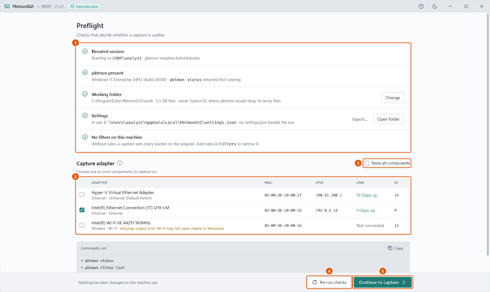

1. **Checks.** Each one is green when it's fine, yellow when it's worth knowing about, and red when it would stop a capture. Some have a button to fix or review the problem.
2. **Capture adapter.** Tick the components to capture on. PktmonGUI remembers your choice by MAC address, because pktmon's component IDs change at reboot.
3. **Show all components.** Lists the filter drivers, protocols and hidden components too, for captures at a specific layer.
4. **Re-run checks**. For example, after stopping a session or changing a folder.
5. **Continue to capture.** Creates the working folder if needed and opens the Capture page. It's available once nothing is red, and at least one component is ticked.

### The checks

| Check | Green | Yellow or red, and what to do |
|---|---|---|
| **Elevated session** | PktmonGUI runs as administrator | Red: restart PktmonGUI as administrator |
| **pktmon present** | pktmon is there and no capture is running | Red if Windows is older than build 19041, if pktmon is missing, or if a capture is already running. **Stop it** ends a session another administrator or a crashed PktmonGUI left running; that capture's `.etl` is kept |
| **Working folder** | The folder is safe and has room | Yellow if other accounts could read or change it, or there's less than 1 GB free. **Change** picks another folder. PktmonGUI never uses the Windows folder |
| **Settings** | Which settings file is in use | Yellow when a `settings.json` beside the exe wasn't loaded because another account could have written it. **Review…** shows each change before importing it; **Ignore** keeps your settings. See the Admin Guide. **Export…** saves your settings as a template ([below](#saving-your-setup-as-a-settingsjson)) |
| **Machine filters** | No filters, or PktmonGUI's own from last time | Yellow when someone else's filters are on the machine, such as Defender for Endpoint's. **Review** lists them. They're saved before PktmonGUI clears them and put back when it closes |

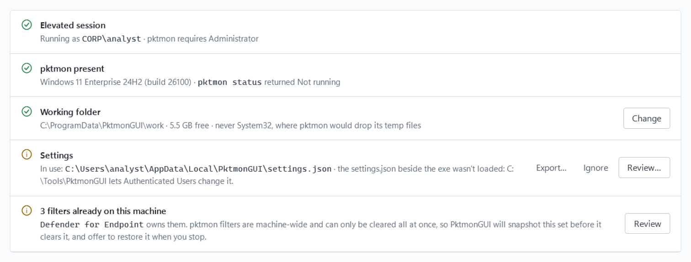

If PktmonGUI was killed or crashed after clearing someone else's filters, the next launch adds one more row, **A previous session didn't restore its filters**. **Restore now** puts them back; **Dismiss** forgets the snapshot (the file stays on disk).

### Choosing what to capture on

Usually you want one network adapter. Without one, pktmon captures at every layer and each packet appears several times.

- Ticking more than one component captures on all of them in one session.
- A Wi-Fi adapter can be captured, but its `.etl` may not convert cleanly for Wireshark (the warning in its row says so). Live mode is unaffected.
- **Show all components** lists every component under its adapter. Capture on a filter driver or on TCP/IP when you need to see whether a packet reaches that layer, or where it's dropped.

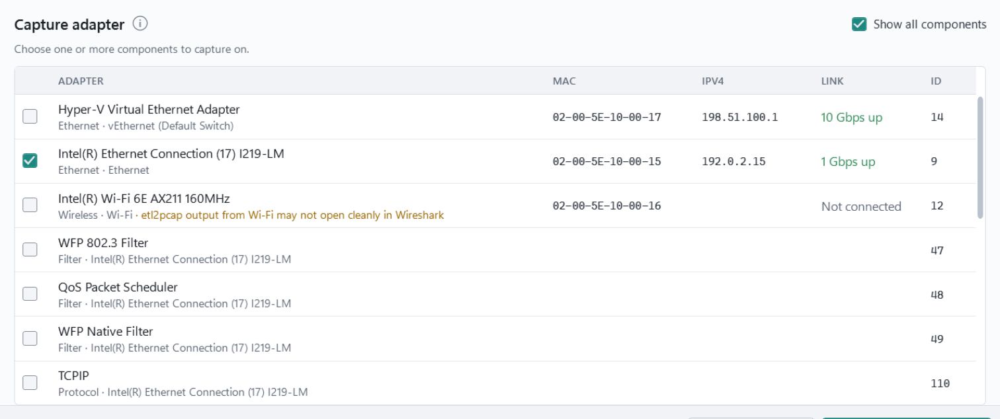

### Saving your setup as a settings.json

To reuse a setup on other machines, set up the window the way you want (capture options, filter rules, theme), then click **Export…** on the **Settings** row and save `settings.json` into the folder with `PktmonGUI.exe`. The file holds your preferences only, never this machine's adapters or the filters PktmonGUI applied to it.

A `settings.json` beside the exe is a template: PktmonGUI imports it when it starts, and headless captures take their defaults from it. The Admin Guide explains [when a template is trusted](admin-guide.md#shipping-settings-with-the-exe) and what it can hold.

Preflight stays in the sidebar, so you can come back to re-run the checks or pick other adapters at any time.

## Capture

The Capture page starts and stops captures and shows the packets.

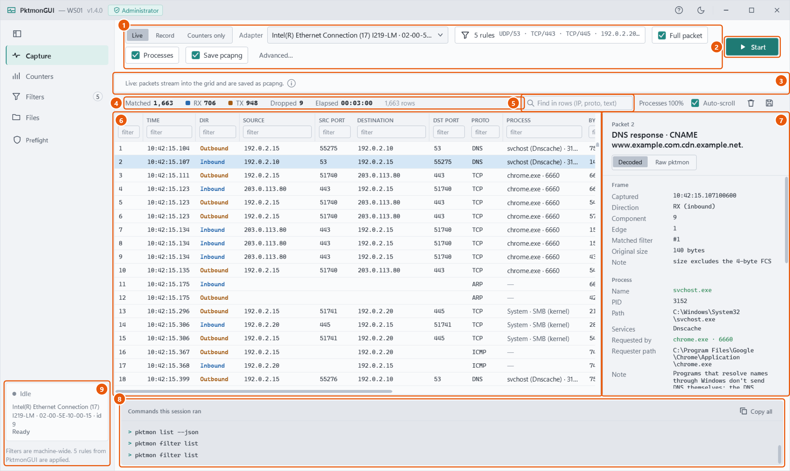

1. **Options**: mode, adapter, filter rules and what to record. See below.
2. **Start** (and **Stop** while a capture runs). In Record mode it says **Record**, in Counters-only mode **Count**.
3. **Banner**: what the mode does, warnings, and the result of the last capture.
4. **Stats**: packets matched, received (RX), sent (TX) and dropped, how long the capture has run, and how many rows the grid holds.
5. **Find**: search every column at once.
6. **Packet grid**: one row per packet. See [Reading packets](#reading-packets).
7. **Decoder**: the selected packet, field by field.
8. **Commands this session ran**: every pktmon command, with its output. **Copy all** copies them.
9. **Session card**: what's running, where, and which filters are on the machine.

### The options

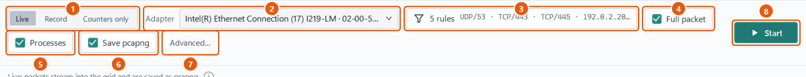

1. **Mode**: Live, Record or Counters only.
2. **Adapter**: the components ticked in Preflight, each adapter on its own, or every network adapter.
3. **Rules**: how many filter rules you have and what they are. Click it to edit them on the Filters page. *not applied* means your rules differ from the machine's.
4. **Full packet**: log whole packets. Clear it to log only the first bytes of each (the snap length, 128 by default). Full packets are needed for DNS answers and CDP/LLDP detail; a snap length keeps files small.
5. **Processes**: work out which process owns each packet. On by default.
6. **Save pcapng** (Live mode): also save the real packet bytes to `live-<date>-<time>.pcapng` in the working folder.
7. **Advanced…**: packet type, event mask, extra ETW providers and the grid's row limit.
8. **Start**.

Hover over any option to see what it does and the pktmon flag behind it:

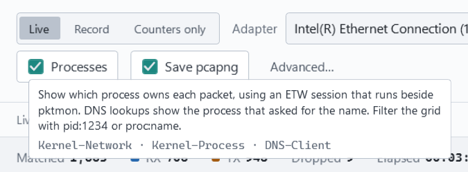

### Capture modes

**Live** streams packets into the grid as they arrive. It's the mode for watching something happen. pktmon's live output is text, so with **Save pcapng** on, PktmonGUI also records each packet's real bytes from the pktmon driver's own event provider into a pcapng for Wireshark: one interface per component, named after its adapter, with drops marked and a process comment on every packet once you stop. The file is capped at 2 GB. pktmon also pre-allocates its own `PktMon.etl` (512 MB) in the working folder; the Files page can convert it.

**Record** writes an `.etl` file without showing packets as they arrive; they load into the grid after you stop. It's the mode for long captures, or for capturing something you'll analyse later.

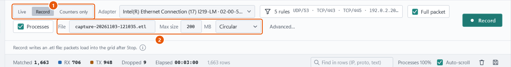

1. **Record** is selected.
2. **File**, **Max size** and the log mode:
   - **Circular** (the default): when the file is full, the oldest packets are overwritten, so you keep the most recent stretch.
   - **Multi-file**: when the file is full, pktmon starts a new one (`name1.etl`, `name2.etl`, …). Nothing is lost, but the disk can fill up. pktmon writes in 16 MB buffers, so under load each file grows well past the size you set.
   - **Memory**: keeps everything in memory and writes it at Stop.

**Counters only** counts packets per component and stores nothing. It answers "is this traffic arriving at all?" cheaply. The totals are on the Counters page, which opens when the capture starts.

### Advanced options

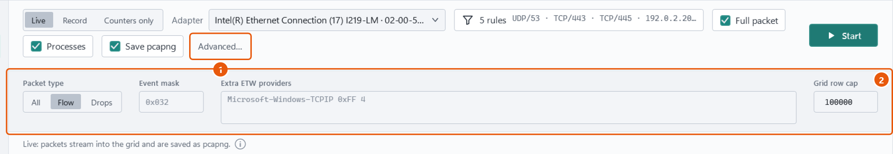

1. **Advanced…** shows or hides them.
2. The options:
   - **Packet type**: **All**, **Flow** (normal traffic only) or **Drops** (only packets the stack discarded, with the reason).
   - **Event mask**: which kinds of pktmon events to log. The default, `0x032`, is right for nearly every capture.
   - **Extra ETW providers**: trace other Windows event providers alongside the packets, one per line, e.g. `Microsoft-Windows-TCPIP 0xFF 4`. Their events appear in an **ETW provider events** panel beside the command log, on the same clock as the packets: the stack's own account of a reset or a drop.
   - **Grid row cap**: how many rows the grid keeps (100,000 by default). Older rows are dropped past it; the capture file isn't affected.

### Starting and stopping

When you click **Start**, PktmonGUI checks a few things first:

- **Your rules aren't on the machine yet.** pktmon reads its filters when a capture starts, so PktmonGUI offers to apply them first (**Apply and start**), or to start with the machine's filters as they are.
- **Someone else's filters are on the machine** and you have no rules of your own. Those filters decide what you'll see, so PktmonGUI asks before capturing through them.
- **The Record file already exists.** PktmonGUI asks before pktmon overwrites it.

While a capture runs, the button turns into a red **Stop**, the options are locked, and the session card says what's running:

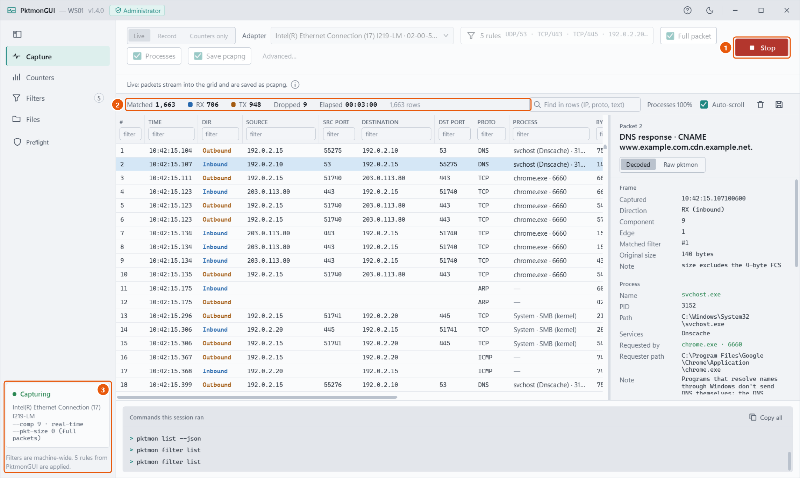

1. **Stop** ends the capture.
2. The counts and the elapsed time update as packets arrive.
3. The **session card** shows the components and the main options in use. Below it, a note says which filters are on the machine.

After **Stop**:

- **Live** with **Save pcapng**: the banner says where the pcapng is and how many packets have a process comment. **Open in Wireshark** opens it (given Wireshark is installed on the machine); **Show in folder** opens Explorer.
- **Record**: the packets load into the grid (the newest 100,000 by default). A multi-file capture loads its newest files, up to 512 MB.

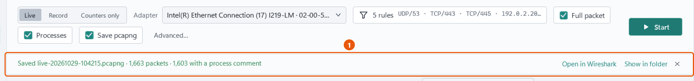

1. The result. Click × to dismiss it.

## Reading packets

### The grid

| Column | What it shows |
|---|---|
| **#** | The packet's number in the capture |
| **TIME** | When pktmon saw it, to the microsecond |
| **DIR** | **Inbound** (received) or **Outbound** (sent) |
| **SOURCE**, **SRC PORT**, **DESTINATION**, **DST PORT** | Addresses and ports |
| **PROTO** | The protocol, as far as pktmon's text shows: DNS, TCP, ARP, ICMP… |
| **PROCESS** | The program that owns the packet (see [Which process sent a packet](#which-process-sent-a-packet)) |
| **BYTES** | The packet's size |
| **INFO** | pktmon's summary of the packet |

Dropped packets are shown in red.

**Sorting.** Click a column title to sort by it: ascending, then descending, then back to capture order. Addresses sort by value, sizes and ports as numbers. While the grid is in capture order, **Auto-scroll** follows new packets.

**Other controls** on the right of the stats bar: the bin icon clears the grid (the capture keeps running), and the disk icon saves the rows as pktmon text. Right-click a packet to copy its pktmon lines, show only its process, or copy the process's path.

### Filtering the grid

Each column has a filter box under its title. Filters only change what the grid shows; they don't change what's captured. Filters on several columns, and the Find box, must all match.

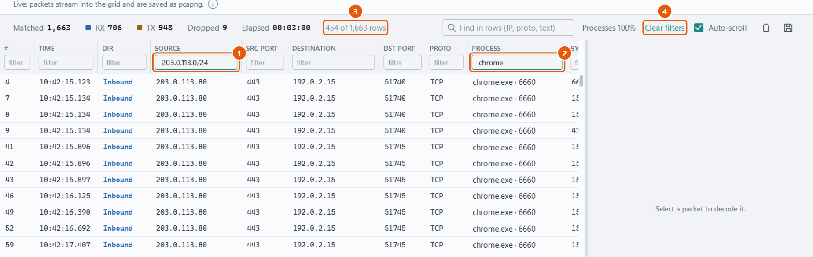

1. **SOURCE** filtered to a subnet.
2. **PROCESS** filtered to a name.
3. How many rows match, out of how many.
4. **Clear filters** empties every box.

| Column | Examples |
|---|---|
| Numbers (#, BYTES) | `1500`, `>1000`, `<=60`, `100-200` |
| TIME | `>18:23:26`, `18:23:26-18:23:27`, or any part of the time |
| SOURCE, DESTINATION | `10.0.0.5`, a subnet such as `10.0.0.0/8` or `fe80::/10`, or a port such as `:443` |
| SRC PORT, DST PORT | `443`, `>1024`, `8000-8100` (ARP and ICMP have no port, so they never match) |
| PROCESS | A name (`chrome`), a service (`Dnscache`), part of a path (`\Windows\Temp\`) or a PID (`4312`) |
| DIR | `in` or `out` |
| Any text column | Any part of the text; `=TCP` for an exact match |

In every column, `|` separates alternatives and `!` excludes: `!ARP|!STP` hides ARP and STP.

### Find

The **Find** box above the grid searches every column at once. Two prefixes search by process:

- `pid:1234` shows the packets of process 1234.
- `proc:chrome` shows the packets of processes whose name, service or path contains *chrome*.

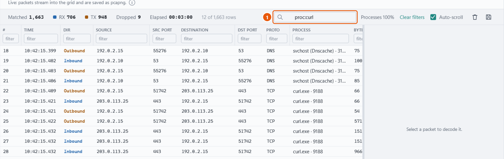

1. `proc:curl` finds curl's own TCP connection and also the DNS lookups that the DNS Client service made on curl's behalf (see below).

### The decoder

Select a packet to decode it in the pane on the right. **Decoded** lists its fields by layer, with the process that owns it. **Raw pktmon** shows exactly what pktmon printed, and under **Reading the symbols** explains each symbol in it, such as TCP's `S` and `.` or DNS's `+` and `*`.

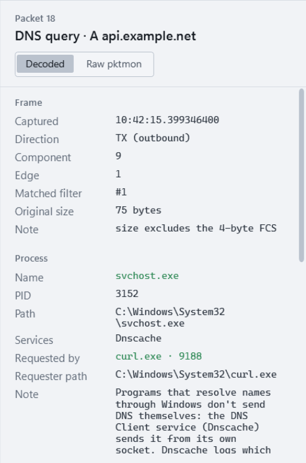

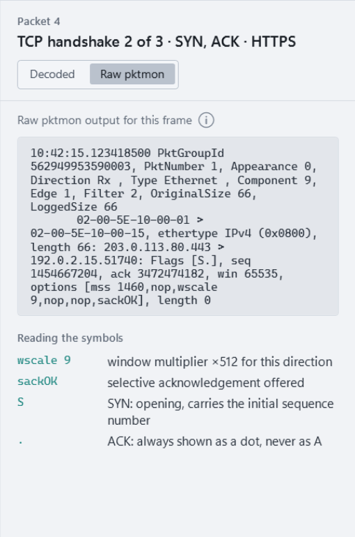

pktmon's real-time output is text, so the decoder can only explain what pktmon printed. For full dissection, open the capture in Wireshark.

### Which process sent a packet

With **Processes** on, PktmonGUI runs a second, lightweight trace beside pktmon (an ETW session called `PktmonGUI-Attribution`, reading Microsoft-Windows-Kernel-Network, Kernel-Process and DNS-Client). It matches each packet to a process per connection, by addresses and ports, using those events and the system's TCP and UDP connection tables. The stats bar shows what share of packets it has matched; hover over it for the detail.

A process's full path comes from the event Windows logs as it starts, so even a process that exits within milliseconds, like a quick `curl`, keeps its path. Processes already running when the capture starts are asked for theirs.

What the PROCESS column can show:

| Shown | Meaning |
|---|---|
| `chrome.exe · 6660` | The process and its PID. The decoder adds its full path, so a familiar name running from an unusual folder stands out |
| `svchost (Dnscache) · 3152 for chrome.exe · 6660` | DNS sent by the DNS Client service on behalf of another program (see below) |
| `System · SMB (kernel)` | PID 4: traffic handled inside the kernel, such as SMB or HTTP.sys |
| `—` | No local process: ARP, ICMP, broadcasts nobody listens to, and traffic between other machines (forwarded or VM traffic). Hover for the reason |
| `?` | No process could be found for this connection |
| `…` | Still waiting for the event that names the process |

**DNS lookups.** Programs that resolve names through Windows (browsers, curl, PowerShell) don't send DNS themselves: the DNS Client service does it for them, from its own socket. PktmonGUI reads the service's record of each query and names both processes, so `pid:` and `proc:` find a program's lookups as well as its connections. Two exceptions:

- Programs that send their own queries, such as `nslookup`, show as themselves.
- A name answered from the DNS cache sends no packet, so it isn't in the capture at all. Sysmon's event 22 logs those too, because it records the lookup rather than the packet.
- On Windows builds whose DNS Client events don't record the requesting process, DNS stays attributed to `svchost (Dnscache)` alone.

Process data is saved with Record captures (as `<name>.attribution.json` beside the `.etl`), so packets loaded later show their processes too.

## Filters

The Filters page builds the list of rules pktmon uses to decide what to capture, and applies it to the machine.

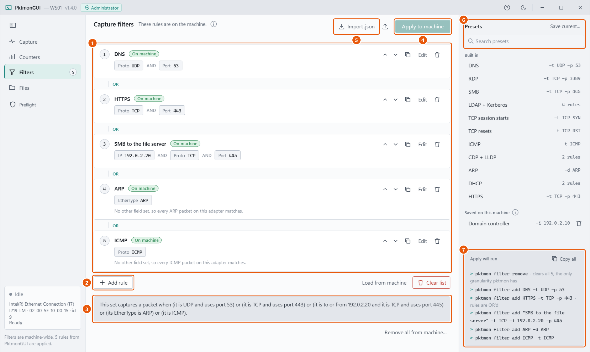

1. **Your rules**, in order. Each shows its fields and whether it's on the machine.
2. **Add rule**.
3. **The sentence**: the whole set read back in plain English, the way pktmon will apply it.
4. **Apply to machine**: replaces the machine's filters with your list.
5. **Import .json** and export (the arrow icon beside it): save your rules to a file, or load rules or presets from one.
6. **Presets**: built-in rule sets, and ones you've saved. Click one to add its rules.
7. **Apply will run**: the exact commands Apply will send.

### How pktmon filters work

- **Fields on one rule are ANDed.** A rule with *TCP* and *port 443* matches TCP packets that use port 443.
- **Separate rules are ORed.** A packet is captured if any rule matches.
- **No rules means everything** on the chosen components is captured.
- **At most 32 rules.**
- **An address or port matches either side.** pktmon has no "source" or "destination".
- **No ranges and no negation.** There's no "not UDP" and no "ports 8000-8100": add one rule per port. (The grid's own filters, which only change the display, do have both.)
- **Filters are machine-wide.** There's one set for the whole machine, and pktmon can only remove all of it at once.

### Building a rule

Click **Add rule**, or **Edit** on an existing one.

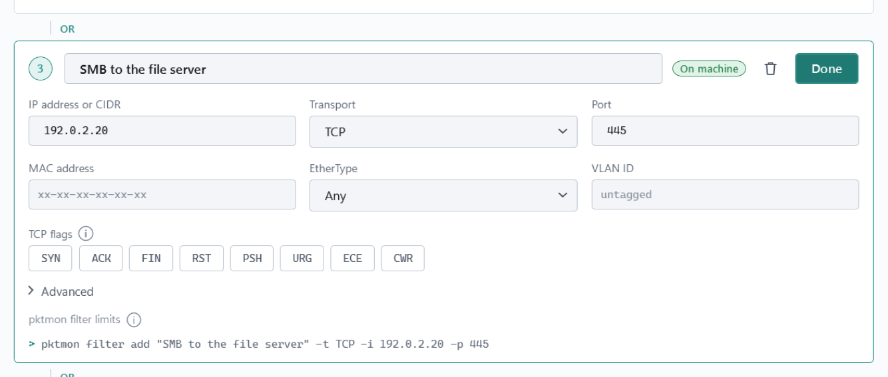

| Field | What it matches | pktmon flag |
|---|---|---|
| **Name** | Nothing; it labels the rule, here and on the machine | |
| **IP address or CIDR** | An address or subnet, as source or destination | `-i` |
| **Transport** | TCP, UDP, ICMP, ICMPv6, or a protocol number (47 GRE, 50 ESP, 89 OSPF) | `-t` |
| **Port** | One port, as source or destination | `-p` |
| **MAC address** | A MAC, as source or destination | `-m` |
| **EtherType** | IPv4, IPv6, ARP, or a number such as `0x88CC` | `-d` |
| **VLAN ID** | An 802.1Q VLAN | `-v` |
| **TCP flags** | Any one of the selected flags (needs Transport TCP) | `-t TCP <flags>` |

**Advanced** adds a second IP, port or MAC (to match only traffic *between* two), DSCP, cluster heartbeat traffic, and encapsulation (to match inner and outer headers of VXLAN, GRE, NVGRE or IP-in-IP).

PktmonGUI checks each rule as you type and won't apply one pktmon would reject. A rule that matches exactly the same packets as another isn't added; an edit that makes two rules the same is flagged until you change one. Use the arrows to reorder rules (the order sets each rule's number), the copy icon to duplicate one, and the bin to remove it. **Done** closes the editor.

### Presets

**Built in**: DNS, RDP, SMB, LDAP + Kerberos, TCP session starts (every SYN), TCP resets, ICMP, CDP + LLDP (which switch port am I on?), ARP, DHCP and HTTPS.

**Saved on this machine**: **Save current…** saves your list under a name. Saved presets live in `presets.json` in your settings folder.

To share rules, use export and **Import .json**. The same file can be given to headless captures (see the Admin Guide).

### Applying to the machine

Your list and the machine's filters can differ: you may be editing, or someone else may have changed the machine. Each rule shows its status, and the status line at the top says whether anything is waiting to be applied.

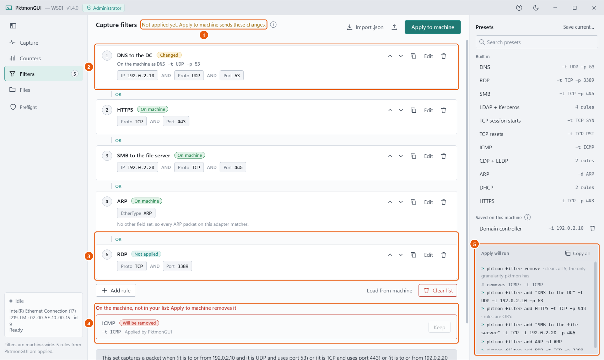

1. **Status**: *Not applied yet* until you click **Apply to machine**.
2. **Changed**: you edited a rule that's on the machine; the line under its name shows how it's on the machine now.
3. **Not applied**: a new rule.
4. **Will be removed**: a filter on the machine that's not in your list. **Keep** puts it back in your list.
5. **Apply will run**: removing everything, then adding your rules, with notes on what's lost.

Rules that match the machine show **On machine**.

**Apply to machine** replaces the machine's filters with your list. pktmon reads its filters when a capture starts, so Apply is unavailable while a capture runs and changes apply to the next one. If you forget, PktmonGUI offers to apply when you click Start.

### Filters PktmonGUI didn't set

Other tools use pktmon too, notably Microsoft Defender for Endpoint, whose filters are named `SenseNdr…`. Because pktmon can only clear every filter at once, applying your rules would remove theirs. PktmonGUI makes this visible and reversible:

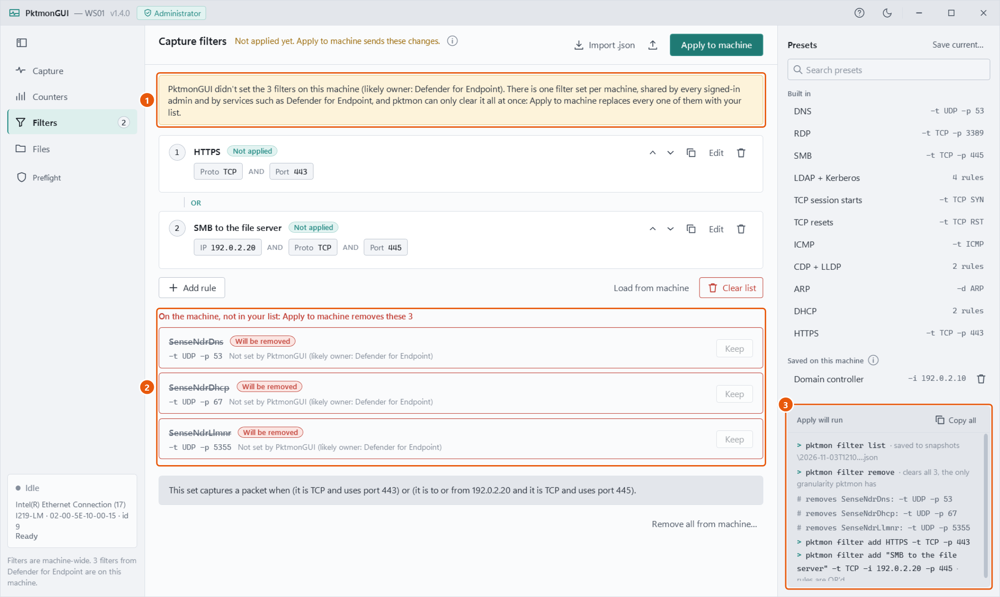

1. A banner says whose filters are on the machine.
2. Each one is listed under **Will be removed**.
3. **Apply will run** starts by saving them to a snapshot.

When you apply, PktmonGUI asks first:

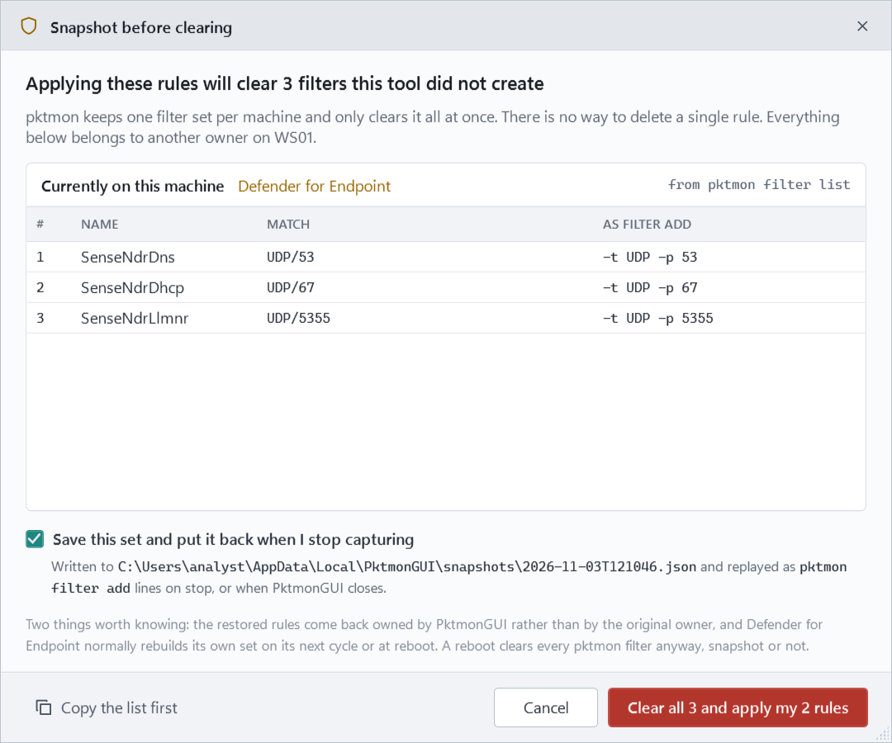

With **Save this set and put it back** ticked (the default), PktmonGUI saves the filters to a file in your settings folder and replays them when you stop capturing or close PktmonGUI. The Filters page offers **Restore now** while a snapshot is held. Restored filters come back owned by PktmonGUI, and Defender for Endpoint normally rebuilds its own set anyway; a reboot clears every pktmon filter.

### Other buttons

- **Load from machine**: replace your list with the filters on the machine.
- **Clear list**: empty your list. The machine keeps its filters until you apply.
- **Remove all from machine…**: remove every filter from the machine, after listing them and offering a snapshot. Your list stays as it is.

## Counters

The Counters page shows pktmon's own counts for the running capture, in every mode: packets and bytes per component, and drops with their reasons. It updates while a capture runs, every second by default (**Refresh** sets how often).

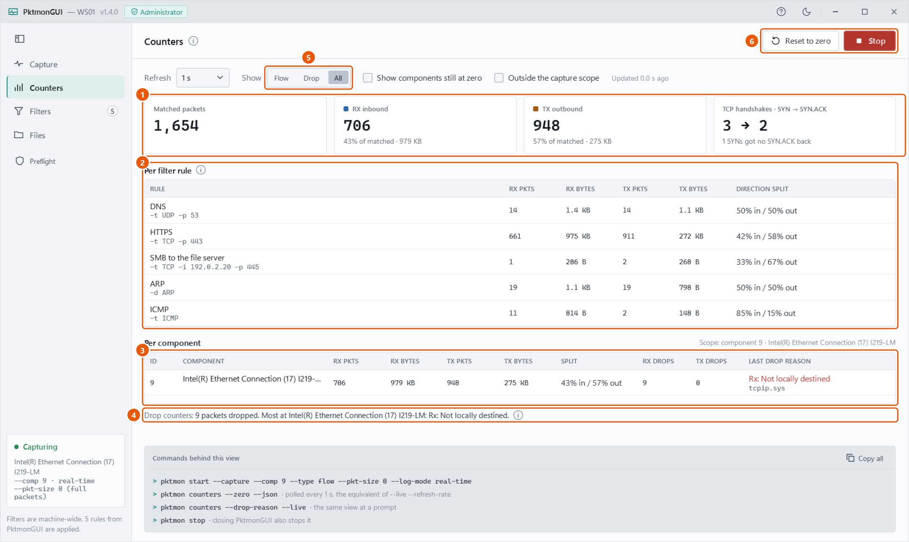

1. **Totals**: packets matched, received and sent, and TCP handshakes (SYNs sent against SYN-ACKs received, which shows connection attempts that got no answer).
2. **Per filter rule** (Live mode only): packets and bytes for each rule, and the split between directions. *nothing is coming back* stands out when a rule only sees one direction.
3. **Per component**: counts for each component in the capture, with drops and the last drop reason, and the drivers that dropped them.
4. **Drop counters**: a one-line summary of where most drops happen and why.
5. **Show**: **Flow**, **Drop** or **All** columns. Beside it, **Show components still at zero** and **Outside the capture scope** list more components.
6. **Reset to zero** restarts the counts; **Stop** ends the capture.

Counts start when the capture starts, not at boot. To see the dropped packets themselves rather than their count, capture with packet type **Drops** (Capture ▸ Advanced).

## Files

The Files page lists every capture in the working folder and converts them for Wireshark.

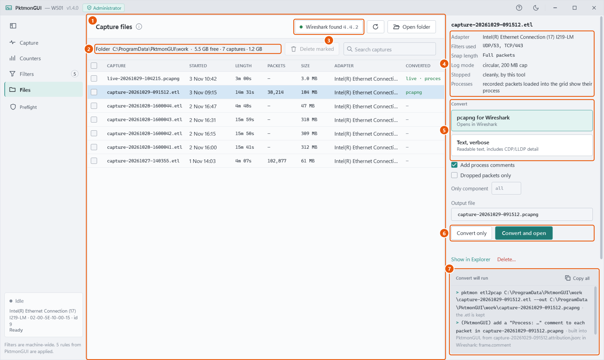

1. **Capture files**: every `.etl` in the working folder, and every Live capture saved as pcapng, newest first, with when it started, how long it ran, its size, the adapter and whether it's been converted.
2. **Folder**: where they are, and the free space. **Open folder** opens it in Explorer.
3. **Wireshark found** (or *not found*): whether PktmonGUI can open files in Wireshark.
4. **Details** of the selected capture: adapter, filters used, snap length, log mode, how it stopped, and whether process data was recorded.
5. **Convert**: to **pcapng for Wireshark**, or to **Text, verbose**.
6. **Convert only** or **Convert and open**.
7. **Convert will run**: the exact commands.

### Converting to pcapng

Select a capture and choose **pcapng for Wireshark**. The options:

- **Add process comments**: write each packet's process into the pcapng as two comments, e.g. `Process: chrome.exe (PID 6660)` and `Process path: C:\Program Files\…\chrome.exe`. Available when the capture recorded process data.
- **Dropped packets only**: keep only the packets the stack discarded.
- **Only component**: keep only the packets from one component (by ID).
- **Output file**: the name of the pcapng, in the working folder. An existing file of that name is overwritten.

**Convert and open** opens the result in Wireshark. Wireshark (and the text viewer) open as you, without administrator rights, so a problem in them can't run as administrator.

**Wi-Fi captures.** pktmon's conversion is documented for wired Ethernet; a Wi-Fi capture may not open cleanly. **Relabel as Wi-Fi (editcap)** tries Wireshark's `editcap` on the result. It's experimental.

### Text, verbose

**Text, verbose** converts with full decode to a text file, optionally with a hex dump of each packet. It's the only way to read the detail of CDP and LLDP packets (which switch and port you're connected to).

### Multi-file captures

A multi-file recording appears as its parts. Select any part and choose pcapng to get **Join all N parts into one file**: PktmonGUI converts every part, joins them in capture order into one pcapng, adds the process comments, and opens it.

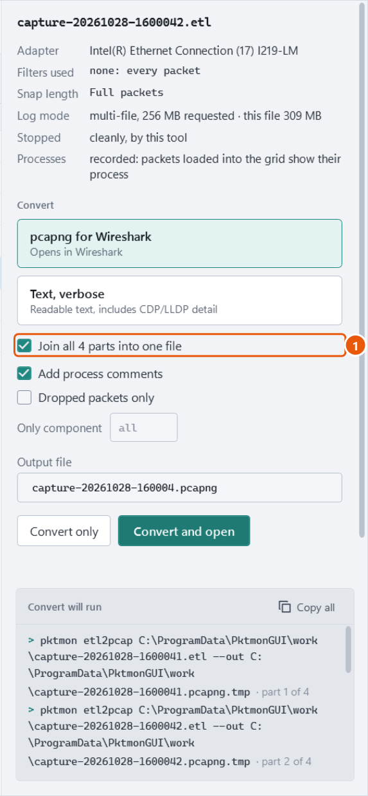

1. **Join all 4 parts into one file**. Clear it to convert only the selected part.

### Live captures saved as pcapng

A Live capture saved as pcapng needs no conversion: **Open in Wireshark** opens it, and **Re-apply process comments** writes the comments again.

### Deleting

Tick captures in the first column and click **Delete marked** (or press Del), or use **Delete…** for the selected one. A capture's sidecar files (metadata, process data and converted files) go with it. A capture that's still running can't be deleted.

## Analysing a capture in Wireshark

Captures converted with process comments carry each packet's process in Wireshark's packet comments (`frame.comment`). The process always comes first and its path second.

**Show them as columns.** In Wireshark, add two custom columns (**Edit ▸ Preferences ▸ Appearance ▸ Columns**, or right-click a column title ▸ **Column Preferences**), both with the field `frame.comment`: one with field occurrence **1** (the process) and one with occurrence **2** (the path).

**Filter by process:**

```
frame.comment contains "curl.exe"
```

**Filter by path.** `matches` ignores case and needs no doubled backslashes:

```
frame.comment matches "windows.temp"
```

`contains` is case-sensitive, and backslashes must be doubled: `frame.comment contains "C:\\Windows\\Temp\\"`.

DNS sent by the DNS Client service names both processes, e.g. `Process: svchost.exe (PID 3152; Dnscache) for curl.exe (PID 1516)`, so a filter on `curl.exe` finds its lookups too.

### Wireshark process metadata dissector

The repository's `tools` folder has [`process_comment.lua`](../tools/process_comment.lua), a lightweight Lua post-dissector for Wireshark. It reads the process comments in a pcapng (`frame.comment`) and exposes the process as fields of its own, for custom columns and display filters.

#### Features

- Extracts the process executable name.
- Extracts the process PID.
- Extracts the full executable path.
- Supports process attribution involving chained processes (e.g., `svchost.exe` acting on behalf of `chrome.exe`).
- Exposes the extracted information as Wireshark fields that can be used in custom columns and display filters.

#### Installation

1. Locate your Wireshark **Personal Lua Plugins** folder:
   - Open Wireshark.
   - Go to **Help ▸ About Wireshark ▸ Folders**.
   - Find the **Personal Lua Plugins** folder.
2. Copy `process_comment.lua` into that folder.
3. Restart Wireshark to load the plugin.

Alternatively, if your Wireshark version offers it, use **Analyze ▸ Reload Lua Plugins** to load the script without restarting Wireshark.

#### Configuring custom columns

Once the plugin is loaded, Wireshark has these fields:

| Field | Description |
|---|---|
| `procmeta.name` | Process executable name (e.g., `chrome.exe`) |
| `procmeta.pid` | Process ID (e.g., `15244`) |
| `procmeta.fullpath` | Full executable path |
| `procmeta.description` | Original process metadata string |

To show them in the packet list:

1. Go to **Edit ▸ Preferences ▸ Appearance ▸ Columns**.
2. Click **+** to add a new column.
3. Configure the column:
   - **Title:** Process
   - **Type:** Custom
   - **Fields:** `procmeta.name`
4. Repeat for any other fields you want to show:
   - **Process PID:** `procmeta.pid`
   - **Process Path:** `procmeta.fullpath`
5. Click **OK** to apply the changes.

The fields work in display filters too, e.g. `procmeta.name == "chrome.exe"` or `procmeta.pid == 15244`. The PID is a number, so ranges work as well: `procmeta.pid > 1000`.

#### Example

Given this packet comment:

```text
Process: svchost.exe (PID 3356; Dnscache) for chrome.exe (PID 15244)
Process path: C:\Windows\System32\svchost.exe for C:\Program Files\Google\Chrome\Application\chrome.exe
```

The extracted fields are:

| Field | Value |
|---|---|
| `procmeta.name` | `chrome.exe` |
| `procmeta.pid` | `15244` |
| `procmeta.fullpath` | `C:\Program Files\Google\Chrome\Application\chrome.exe` |

When no chained process is present, the script uses the primary process information. When PktmonGUI couldn't read a process's name (`unknown name`), only `procmeta.pid` is set.

#### Requirements

- Wireshark 4.6.9 (tested version).
- Lua scripting support enabled in Wireshark.
- pcapng captures with process information in their packet comments.

## Common tasks

### Find out which program talks to an address

1. On **Filters**, add a rule with the address in **IP address or CIDR**, and apply it.
2. On **Capture**, make sure **Processes** is ticked, and start a **Live** capture.
3. When the traffic happens, read the **PROCESS** column, or select a packet to see the process's full path.
4. To see everything that program does, right-click a packet ▸ **Show only this process**.

### Find out why packets are dropped

1. Start a capture on the adapter (any mode) and open **Counters**. Set **Show** to **Drop**: the components that drop packets, and why.
2. To see the dropped packets themselves, stop, set **Capture ▸ Advanced ▸ Packet type** to **Drops**, and capture again. Each dropped packet shows its reason in the decoder.
3. To see which layer drops them, tick **Show all components** in Preflight and capture on the adapter and on the layers above it.

### Capture DNS for an hour

1. On **Filters**, add the **DNS** preset and apply it.
2. On **Capture**, choose **Record**, keep **Circular**, and set **Max size** to a size you can spare. DNS is small; 200 MB holds a lot.
3. Click **Record**, and **Stop** an hour later. The packets load into the grid; the Files page converts the `.etl` for Wireshark.

### Record a long capture without filling the disk

pktmon records at line rate: at 100 Mbit/s of full packets, 512 MB lasts under a minute. Some ways to make a capture last:

- Narrow it with filters to the traffic you need.
- Log headers only: clear **Full packet** and keep a snap length of 128 bytes.
- Use **Circular** with a larger **Max size**, to keep the most recent stretch.
- Use **Multi-file** to keep everything, and watch the free space on the Files page.

### Capture at a specific point in the stack

1. In Preflight, tick **Show all components**.
2. Tick the components you want, for example the adapter and its **TCP/IPv4 - L3/L4** component, and continue.
3. Capture as usual. The same packet appears once at each component; the **Component** field in the decoder says which.

## Closing PktmonGUI

However PktmonGUI closes, it:

1. stops its own capture, if one is running;
2. puts the machine's filters back as it found them: it replays a snapshot of someone else's filters if it holds one, or else removes its own rules (your list is kept for next time);
3. stops its process-attribution trace.

A short "Stopping capture and restoring filters…" message shows while it does this.

If PktmonGUI is killed or crashes, pktmon may keep recording and the filters may stay replaced. The next launch's Preflight finds both: **pktmon present** offers **Stop it** for the leftover session, and a row offers to restore the saved filters. PktmonGUI also stops any attribution trace a crashed instance left behind.

## The tour, themes and shortcuts

### The guided tour

A one-minute tour points out the main screens and buttons, one at a time. PktmonGUI offers it after Preflight's checks at each launch, until you tick **Don't offer this tour at startup**. Click **?** in the title bar, or press F1, to take it any time. Use Back and Next or the arrow keys, and Esc to leave. The tour only switches pages; it never starts a capture or changes the machine.

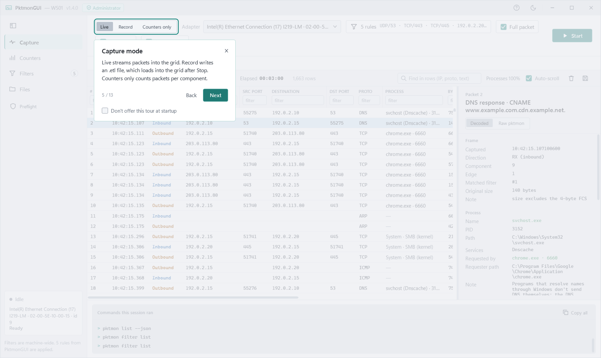

### Theme and layout

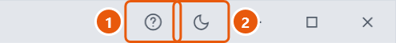

1. **?** starts the tour.
2. The theme button switches between the dark and light themes. Right-click it for **Match Windows**, which follows Windows' own light or dark setting.

The sidebar collapses to icons with the button at its top, or Ctrl+B. Hover over an icon for the page's name.

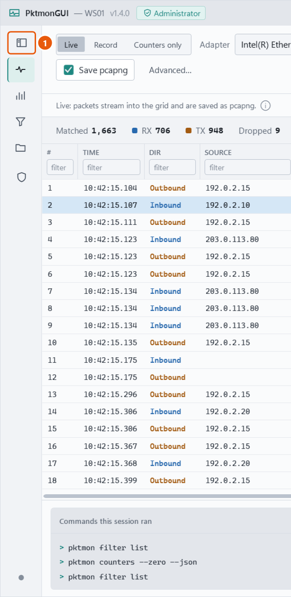

1. The button that collapses and expands the sidebar.

PktmonGUI remembers the theme, the sidebar, the window's size and most options between sessions. Hovering over the version number in the title bar shows where its settings are kept.

### Keyboard shortcuts

| Keys | Does |
|---|---|
| F1 | Start the tour |
| Ctrl+B | Collapse or expand the sidebar |
| Ctrl+Shift+L | Switch between the dark and light themes |
| Del (Files page) | Delete the marked captures, or the selected one |
| ← → Esc (tour) | Previous step, next step, close |

## Troubleshooting

| Symptom | Cause | What to do |
|---|---|---|
| **Elevated session** is red | PktmonGUI isn't running as administrator | Close it and run it as administrator |
| **pktmon present** is red: build older than 19041 | Windows 10 before 2004, or Server 2019 | Use a newer Windows; older pktmon lacks real-time mode and the syntax PktmonGUI uses |
| **pktmon present** is red: a session is already running | Another administrator's capture, or one a crashed PktmonGUI left | **Stop it** ends it (its `.etl` is kept), or wait for it to finish |
| The grid shows each packet several times | Capturing on several components, or with no component | Capture on one adapter; several components show each packet once per component |
| No packets arrive | Filters that match nothing, the wrong adapter, or someone else's filters on the machine | Check the session card's filter note and the rules button; check the adapter's link in Preflight |
| The PROCESS column shows `?` | The connection started before the capture and has closed, or the trace lost events under heavy load | Start the capture before the traffic; hover over the stats bar's *Processes* figure for detail |
| *not applied* beside the rules | Your list differs from the machine's | **Apply to machine**, or click Start and choose **Apply and start** |
| **Wireshark not found** | Wireshark isn't installed | Install it, or put a portable copy in a `Wireshark` folder beside `PktmonGUI.exe` |
| A Wi-Fi capture opens in Wireshark as garbage | pktmon's conversion is documented for wired Ethernet | Try **Relabel as Wi-Fi (editcap)**, or use Live mode with **Save pcapng** |
| A multi-file capture's files are much bigger than **Max size** | pktmon writes in 16 MB buffers and starts the next file late | Expected; plan for files of several hundred MB |
| **Settings** is yellow | A `settings.json` beside the exe could have been written by another account | **Review…** to see and import it, or **Ignore**; the Admin Guide explains how to make it trusted |
| "Couldn't start Wireshark" | No interactive desktop, so Explorer can't open it as you | Open the file from Wireshark yourself; the message gives its path |

## Glossary

| Term | Meaning |
|---|---|
| **Component** | A point in the network stack pktmon can watch: an adapter, a filter driver, a protocol or a switch port. Each has an ID, which changes at reboot |
| **Drop** | A packet the stack discarded, logged with a reason and a location |
| **Dnscache** | The DNS Client service, which sends DNS queries on behalf of programs |
| **ETL** | Event Trace Log, the format pktmon records in |
| **ETW** | Event Tracing for Windows, the system pktmon and PktmonGUI's process attribution are built on |
| **Filter** (pktmon) | One rule in the machine-wide list deciding what pktmon captures |
| **pcapng** | The capture format Wireshark uses |
| **Preflight** | PktmonGUI's start page, which checks the machine before anything changes |
| **Process attribution** | PktmonGUI's matching of packets to the processes that sent or received them |
| **Snap length** | How many bytes of each packet are logged when **Full packet** is off |
| **Snapshot** | A saved copy of filters PktmonGUI didn't set, replayed when it stops or closes |
| **Working folder** | Where pktmon runs and captures are written: `%ProgramData%\PktmonGUI\work` by default |
